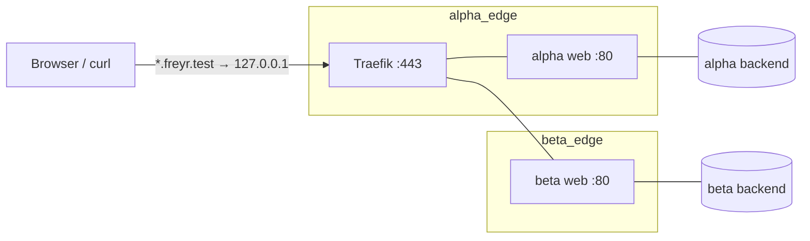

# Traefik local development proxy

HTTPS on a local domain (`https://<name>.freyr.test`) for services that run in
Docker Compose, with each stack on its own isolated network.

- **Traefik v3** on `127.0.0.1:80/443`. HTTP redirects to HTTPS.
- **mkcert** makes a local CA and a wildcard certificate for `DOMAIN` and `*.DOMAIN`.
  No public domain, no Let's Encrypt, no renewal job.
- **dnsmasq** (a container) answers `*.DOMAIN` with `127.0.0.1`. The host sends
  only `DOMAIN` queries to it; all other DNS is unchanged.
- **network-sync** (a container) connects Traefik to the edge network of each
  routed stack, and disconnects it when the stack stops. Stacks share no network,
  so they cannot reach each other. Three nginx servers on port 80 on three
  domains work side by side.



## Quick start

```bash
make create      # mkcert + CA + certificate, start containers, DNS (asks for sudo)
make demo-up     # 3 isolated nginx stacks: https://{alpha,beta,gamma}.freyr.test
make demo-test   # checks DNS, HTTPS, aliases and isolation
make demo-down
```

Requirements: Docker with Compose v2.20+ (OrbStack or Docker Desktop on macOS),
Homebrew on macOS (for mkcert). Linux: install mkcert yourself; DNS setup uses
systemd-resolved.

Dashboard: `https://traefik.freyr.test`. All targets: `make`.

## Route a stack

Give the stack its own edge network, put the routed service on it, and keep
everything else on a private network:

```yaml
# shop/compose.yaml  (project name: shop)
services:
  web:
    image: nginx:alpine            # listens on 80; no host port
    networks: [edge, internal]
    labels:
      traefik.enable: "true"
      traefik.docker.network: shop_edge             # <project>_<network>
      traefik.http.routers.shop.rule: Host(`shop.freyr.test`)
      # Only when the container exposes several ports or none:
      # traefik.http.services.shop.loadbalancer.server.port: "80"
  db:
    image: postgres:17
    networks: [internal]           # Traefik and other stacks cannot reach it

networks:
  edge: {}
  internal: {}
```

`docker compose up -d` is all. network-sync sees the container start and
connects Traefik to `shop_edge`. The rules:

| Rule | Why |
|---|---|
| `traefik.docker.network` is required and is the full network name (`<project>_edge`, or the `name:` you set) | Traefik and network-sync use it to find the network. Without it Traefik can select a network it is not on (504). |
| Router names are unique across all stacks (`shop`, not `web`) | Routers from all containers share one namespace. |
| No `ports:` on routed services | Traefik reaches the container on the edge network. |
| TLS labels are not necessary | The `websecure` entry point has TLS on by default; the wildcard certificate covers every `*.DOMAIN` host. |

### Calls between containers by domain

network-sync gives Traefik every `Host()` name of a network as a network alias
there. A container on `shop_edge` that calls `https://shop.freyr.test` reaches
Traefik, and only for the hosts of its own stack. To trust the certificate,
mount the CA and point the client at it:

```yaml
    volumes:
      - ~/code/freyr/traefik/ssl/rootCA.pem:/usr/local/share/ca-certificates/mkcert.crt:ro
    # Debian/Alpine images: run update-ca-certificates, or set
    # SSL_CERT_FILE / NODE_EXTRA_CA_CERTS / REQUESTS_CA_BUNDLE to that path.
```

A stack that must call another stack joins that stack's edge network as
`external: true`. This is a deliberate hole in the isolation; use it only
where you need it.

## Certificates

| Command | Effect |
|---|---|
| `make certs` | Creates the CA (once per machine) and `ssl/local.crt` for `DOMAIN` + `*.DOMAIN`. Skips when the certificate is valid for 30+ days and matches `DOMAIN`. |
| `make renew-certs` | Makes a new certificate and restarts Traefik. |
| `make cert-info` | Names and expiry. |

The certificate is valid for about 27 months. A wildcard covers one level:
`*.freyr.test` matches `shop.freyr.test`, not `api.shop.freyr.test`. Add more
names in `CERT_EXTRA_NAMES` (for example `*.shop.freyr.test`) and run
`make renew-certs`.

The CA key is in `$(mkcert -CAROOT)/rootCA-key.pem`. Anyone with that file can
make certificates your machine trusts for any site: never copy or commit it.
`ssl/rootCA.pem` is the public part and safe to mount into containers.

## Configuration

`.env` (made from `.env.example` by `make check-env`):

| Variable | Default | Meaning |
|---|---|---|
| `DOMAIN` | `freyr.test` | Local domain. Use `.test` or `.internal`; avoid `.local` (mDNS) and real TLDs. |
| `CERT_EXTRA_NAMES` | empty | Extra certificate names, space-separated. |
| `BIND_IP` | `127.0.0.1` | Host address of ports 80/443. `0.0.0.0` exposes the proxy to the LAN. |
| `DNS_PORT` | `53` | Host port of the dns container (on 127.0.0.1). |
| `TRAEFIK_IMAGE` | `traefik:v3.7` | Traefik image. |
| `TRAEFIK_LOG_LEVEL` | `INFO` | `DEBUG`, `INFO`, `WARN`, `ERROR`. |
| `PROXY_CONTAINER` | `traefik` | Container name of Traefik (network-sync uses it). |

After a change of `DOMAIN`: `make remove-dns` (with the old value), then
`make certs dns start`.

## Files

| Path | Content |
|---|---|
| `compose.yaml` | traefik, dns, network-sync. Traefik static config is in `command:`. |
| `configs/` | Traefik dynamic config (file provider): `certs.toml`. |
| `docker/dnsmasq/` | Image of the dns container. |
| `scripts/` | Scripts behind the make targets, see [scripts/README.md](scripts/README.md). |
| `examples/isolated-stacks/` | The demo stack. |
| `ssl/` | Certificate, key, public CA (gitignored). |

## More

- [SETUP.md](SETUP.md): first-time setup step by step, and the migration from the Let's Encrypt version.
- [TROUBLESHOOTING.md](TROUBLESHOOTING.md)
- [guides/multi-stack-local-development.md](guides/multi-stack-local-development.md): Docker networking patterns.
